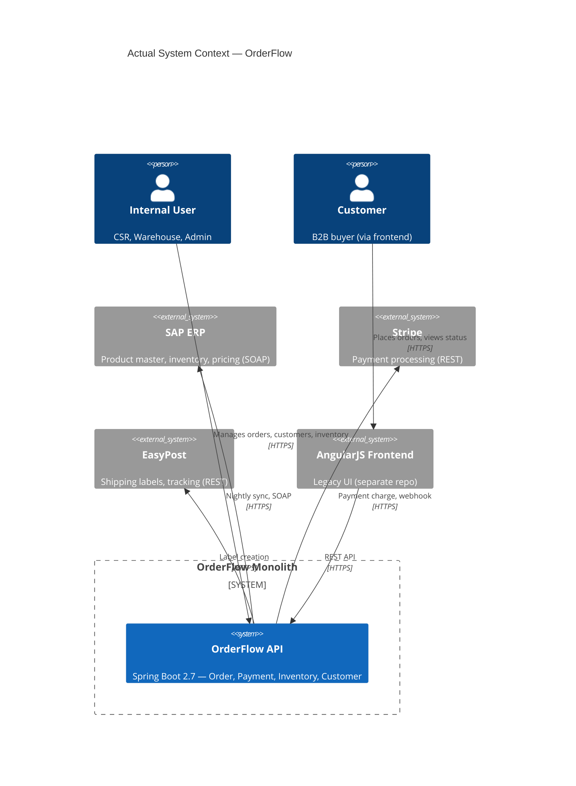

# Gate 3 — Architecture Assessment — OrderFlow Legacy

## 1. Document Metadata

| Field | Value |
|-------|-------|
| Document ID | `GATE-3-ARCH-001` |
| Version | `0.2` |
| Status | `ACTIVE` |
| Created | `2025-01-25` |
| Updated | `2025-01-29` |
| Project | OrderFlow Legacy Assessment |
| Lifecycle Mode | EXISTING_SYSTEM |
| Gate | Gate 3 — Architecture |
| Owner | Architect |
| Reviewers | VP Engineering, Technical Lead, Security Officer |

---

## 2. Purpose

Evaluate whether the **Actual Architecture** of OrderFlow is coherent and can support required quality attributes, or whether remediation is required before feature work.

Per `references/architecture-gates.md` Section 15: `Observed Reality > Historical Documentation`.

---

## 3. Architecture Evaluation Model

| Criterion | Actual State | Required | Gap | Severity |
|-----------|--------------|----------|-----|----------|
| **System Boundary** | Single monolith (Spring Boot) | Clear boundary | ✅ Defined | — |
| **Module Boundaries** | **None** — 3 services share DB, cross-inject | Aligned with domain (Order, Payment, Inventory) | ❌ Violated | `BLOCKING` |
| **Component Responsibilities** | Mixed — controllers call services across domains | Single responsibility per module | ❌ Violated | `BLOCKING` |
| **Communication Patterns** | Sync REST + direct DB writes | In-process (same context), Events (cross-context) | ❌ Violated | `BLOCKING` |
| **Quality Attributes** | See Section 5 | Satisfiable by architecture | ❌ Not satisfiable | `BLOCKING` |
| **External Dependencies** | 3 (SAP, Stripe, EasyPost) — all sync, no resilience | Defined with contracts, resilience | ❌ Violated | `BLOCKING` |
| **Data Ownership** | Ambiguous — 3 writers to `orders` | Single owner per aggregate | ❌ Violated | `BLOCKING` |
| **Architectural Risks** | 6 BLOCKING identified | Addressed or accepted | ❌ 6 BLOCKING open | `BLOCKING` |

---

## 4. Required Architecture Views (Per Gate 3)

### 4.1 System Context (Actual)



### 4.2 Container Architecture (Actual)

```mermaid
C4Container
title Actual Container Architecture — OrderFlow

Container(api, "OrderFlow API", "Spring Boot 2.7 (Java 11)", "Monolith: all modules in single process")
ContainerDb(pg, "PostgreSQL", "RDS (Single AZ)", "orders, payments, inventory, customers")
ContainerDb(mongo, "MongoDB", "Atlas (Shared)", "products, pricing_rules, sap_sync_log")
ContainerQueue(rmq, "RabbitMQ", "EC2 (Self-managed)", "Inventory → SAP sync only")
Container(jenkins, "Jenkins", "EC2 (Same as API)", "Build → Deploy to same EC2")

Rel(api, pg, "JDBC", "Shared schema — 3 services write orders")
Rel(api, mongo, "MongoDB Driver", "Catalog, pricing")
Rel(api, rmq, "AMQP", "Inventory sync only")
Rel(api, sap, "SOAP", "Nightly batch (40% fail)")
Rel(api, stripe, "REST", "Sync charge + unsigned webhook")
Rel(api, easypost, "REST", "Sync label creation")
Rel(jenkins, api, "SCP + SSH", "Deploy JAR → restart")
```

### 4.3 Module Structure (Actual vs Target)

| Module | Actual Responsibilities | Target Responsibilities | Gap |
|--------|------------------------|------------------------|-----|
| **Order** | Create, update, cancel, confirm, list, payment charge, inventory check | Create, update, cancel, confirm, list, **publish events** | Payment/inventory logic leaked in |
| **Payment** | Stripe charge, webhook handling, **updates orders table** | Stripe integration, **consume OrderConfirmed, publish PaymentCompleted** | Owns order payment status, sync call |
| **Inventory** | Availability check (MongoDB), **updates orders table**, SAP sync | SAP integration, **consume OrderConfirmed, publish Reserved/Released** | Owns order inventory status, best-effort check |
| **Customer** | CRUD, profile, SAP customer sync | Customer lifecycle, profile | ✅ Mostly aligned |
| **Reporting** | SQL queries across all tables | Read models, materialized views | ✅ Aligned (read-only) |

---

## 5. Quality Attribute Assessment

| Attribute | Actual | Target | Satisfiable by Current Architecture? | Evidence |
|-----------|--------|--------|--------------------------------------|----------|
| **Availability** | 99.2% (6h downtime/mo) | 99.9% | ❌ No — single EC2, no HA, Stripe sync coupling | Incident Jan 2025: 2h downtime |
| **Performance** | Order confirm P95 3.2s | < 500ms | ❌ No — synchronous Stripe (2.8s) + SAP | Datadog traces |
| **Security** | Critical (4 BLOCKING) | SOC2-ready | ❌ No — auth bypass, secrets, SQLi, unsigned webhook | Penetration test, code audit |
| **Scalability** | Vertical only (t3.large) | Horizontal | ❌ No — single process, shared DB, no caching | CPU 95% at peak |
| **Maintainability** | 0% tests, circular deps | Modular, testable | ❌ No — tangled modules, no tests | ArchUnit: 47 dependency violations |
| **Observability** | Basic APM, no business metrics | Full (metrics, logs, traces, SLOs) | ❌ Partial — no SLOs, no audit trail | Datadog: only infra metrics |
| **Resilience** | None | Circuit breakers, retries, fallbacks | ❌ No — sync external calls, no timeouts | Stripe downtime = order downtime |

**Conclusion:** Current architecture **cannot satisfy** required quality attributes. Fundamental restructuring required.

---

## 6. Required Decisions (Per Gate 3)

| Decision | Status | Blocking Gate 3? |
|----------|--------|------------------|
| Architectural Style (Modular Monolith vs Services) | `PROPOSED` (ADR-001) | Yes — defines module boundaries |
| Communication Pattern (Sync vs Async) | `PROPOSED` (ADR-004) | Yes — defines cross-module comm |
| Data Ownership (Order aggregate owner) | `PROPOSED` (ADR-003) | Yes — resolves triple ownership |
| External Call Resilience | `PROPOSED` (ADR-004) | Yes — required for availability |

**All four decisions are prerequisites for architecture coherence.**

---

## 7. Blocking Conditions

| Blocking Issue | Reason | Affected Artifact | Required Action |
|----------------|--------|-------------------|-----------------|
| **No module boundaries** | Architecture contradicts domain boundaries (Order/Payment/Inventory) | `DOM-BC-001`, `ARCH-CTX-001` | ADR-001 (Target Architecture) |
| **Triple order ownership** | Critical data integrity violations (2% mismatch) | `orders` table, `ADR-003` | ADR-003 (Data Ownership) |
| **Sync Stripe in request path** | Availability coupled to Stripe; 3.2s latency | `OrderController`, `PaymentService` | ADR-004 (External Calls) |
| **Critical security vulnerabilities** | Auth bypass, secrets, SQLi, unsigned webhook | `JwtFilter`, `StripeClient`, `OrderRepository`, `PaymentController` | ADR-002 (Security) |
| **No circuit breakers** | Stripe/SAP/EasyPost failures cascade | All integration clients | ADR-004 (External Calls) |
| **Architectural decisions unresolved** | Implementation depends on unresolved decisions | All feature work | ADR-001..005 |

---

## 8. Non-Blocking Risks (Accepted for Assessment)

| Risk | Reason Accepted |
|------|-----------------|
| Spring Boot 2.7 EOL | Addressed in migration (ADR-001) |
| AngularJS 1.8 Frontend | Separate repo, not blocking API assessment |
| No contract tests | Addressed in ADR-005 (Contract Governance) |
| No staging environment | Addressed in Infrastructure Spec (Gate 7) |
| Decision debt (AuthStrategy=OPEN, etc.) | Addressed by ADR-001..005 |

---

## 9. Gate Evaluation

```
Gate: GATE-3 — Architecture
Status: BLOCKED

Satisfied:
✓ System boundary established (single monolith)
✓ Major components identified (Order, Payment, Inventory, Customer)
✓ External systems identified (SAP, Stripe, EasyPost)
✓ Quality attributes assessed (all gaps documented)
✓ Architectural risks identified (6 BLOCKING)

Blocking:
✗ Architecture contradicts domain boundaries (triple ownership, cross-writes)
✗ Critical system responsibility (order payment status) has no single owner
✗ Critical external dependency (Stripe) synchronous with no resilience
✗ Required quality attributes (availability, performance, security) cannot be satisfied
✗ Major architecture decisions remain unresolved (style, comm, data ownership, resilience)

Non-Blocking Risks:
⚠ Spring Boot 2.7 EOL
⚠ AngularJS 1.8 frontend
⚠ No contract tests
⚠ Decision debt (AuthStrategy=OPEN, DataOwnership=AMBIGUOUS)

Required Actions:
1. Authorize ADR-001 (Target Architecture: Modular Monolith → Service Extraction)
2. Authorize ADR-003 (Data Ownership: OrderService sole owner)
3. Authorize ADR-004 (External Calls: Async + Circuit Breakers)
4. Authorize ADR-002 (Security: OAuth2 + Secrets Management) — **URGENT**
5. Define target module boundaries aligned with bounded contexts
6. Plan strangler fig migration: Order → Payment → Inventory

Next Gate: Gate 4 — Contracts (also BLOCKED)
```

---

## 10. Feedback Loop Triggered

**Architecture Gate BLOCKED → Domain Revisit Required**

The triple ownership issue (RISK-005) reveals that the domain model assumed single ownership. Domain Discovery (Gate 2) must be revisited to:
- Confirm Order aggregate boundaries
- Define Payment and Inventory as separate aggregates with event-based integration
- Update domain invariants to reflect event-driven consistency

This is expected per `references/lifecycle.md` Section 8: Feedback loops are first-class.

---

## 11. Traceability

| Relationship | Artifact | Status |
|--------------|----------|--------|
| `DERIVES_FROM` | `SYS-DISC-001` (System Discovery) | `VALID` |
| `DERIVES_FROM` | `SYS-DVA-001` (Documented vs Actual) | `VALID` |
| `CONSTRAINS` | `RISK-REG-001` (Risk Register) | `VALID` |
| `DECIDES` | `ADR-001` (Target Architecture) | `PROPOSED` |
| `DECIDES` | `ADR-003` (Data Ownership) | `PROPOSED` |
| `DECIDES` | `ADR-004` (External Calls) | `PROPOSED` |
| `DECIDES` | `ADR-002` (Security) | `ACTIVE` |
| `VERIFIES` | `SPEC-001` (Security), `SPEC-002` (Order Extraction) | `IN_PROGRESS` |

---

## 12. Evidence

| Claim | Evidence | Confidence |
|-------|----------|------------|
| No module boundaries | Code: cross-injection, shared repositories | `HIGH` |
| Triple ownership | Code (3 services), DB (updated_by), Invariant violations | `HIGH` |
| Sync Stripe | Code (call chain), Traces (3.2s) | `HIGH` |
| Security critical | Code (JwtFilter, StripeClient, OrderRepository, PaymentController), Pen test | `HIGH` |
| Quality attributes unsatisfiable | Architecture analysis, Datadog metrics | `HIGH` |
| Decisions unresolved | ADR register (PROPOSED), Decision debt audit | `HIGH` |