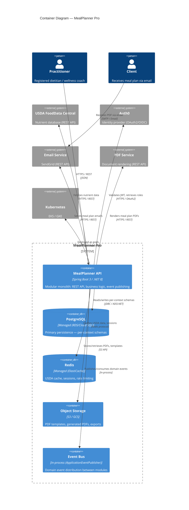
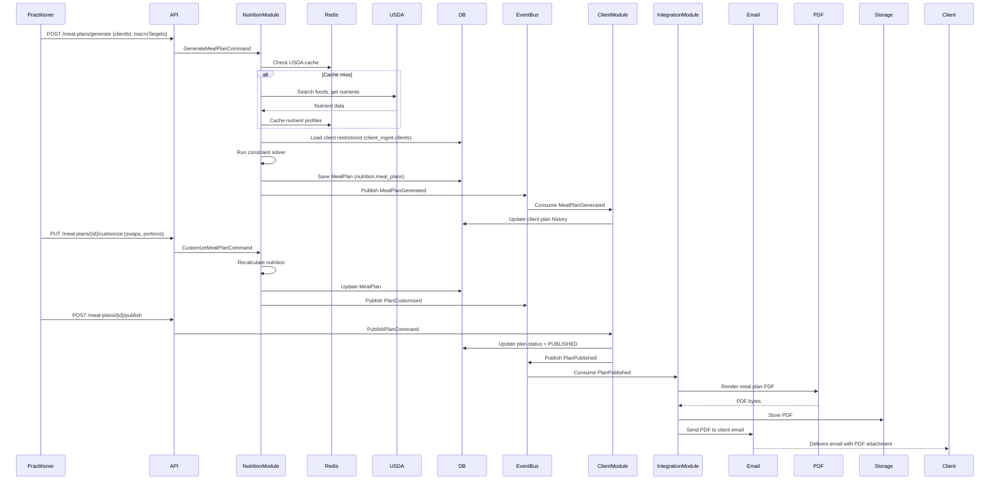

# C4 Container Diagram — MealPlanner Pro

## 1. Document Metadata

| Field | Value |
|-------|-------|
| Document Type | C4 Container |
| Architecture Level | C4 Level 2 |
| Lifecycle Phase | Architecture |
| Status | `IN_REVIEW` |
| Version | `0.2` |
| System | MealPlanner Pro |
| Owner | Architect |
| Created | `2025-01-26` |
| Last Updated | `2025-01-29` |

---

## 2. Container Diagram



---

## 3. Container Descriptions

| Container | Technology | Responsibility | Data |
|-----------|------------|----------------|------|
| **MealPlanner API** | Spring Boot 3 / .NET 8 | All business logic: Nutrition Planning, Client Management, Compliance, Integration modules. Exposes REST API. Publishes/consumes domain events. | Stateless (session in Redis) |
| **PostgreSQL** | Managed (RDS/Cloud SQL) | Primary persistence. Schemas: `nutrition`, `client_mgmt`, `compliance`, `integration`, `shared`. | All domain data |
| **Redis** | Managed (ElastiCache) | USDA nutrient cache (30-day TTL), session store, rate limiting counters. | Cache, sessions |
| **Object Storage** | S3 / GCS | PDF templates, generated meal plan PDFs, data exports. | Documents, templates |
| **Event Bus** | In-process (Spring ApplicationEventPublisher / MediatR) | Distributes domain events between modules. No external broker for MVP. | Events (transient) |

---

## 4. Container Interactions

| From | To | Protocol | Purpose |
|------|-----|----------|---------|
| Practitioner | MealPlanner API | HTTPS / REST | All user interactions |
| MealPlanner API | PostgreSQL | JDBC / ADO.NET | Persistence (per-context schemas) |
| MealPlanner API | Redis | Redis protocol | Caching, sessions, rate limiting |
| MealPlanner API | Object Storage | S3 API | PDF storage, templates |
| MealPlanner API | Event Bus | In-process | Cross-module domain events |
| MealPlanner API | USDA API | HTTPS / REST | Nutrient data fetch |
| MealPlanner API | Auth0 | HTTPS / OAuth2 | Token validation, JWKS |
| MealPlanner API | Email Service | HTTPS / REST | Plan delivery, notifications |
| MealPlanner API | PDF Service | HTTPS / REST | PDF rendering |

---

## 5. Data Flow: Meal Plan Generation



---

## 6. Deployment View

```
┌─────────────────────────────────────────────────────────────┐
│                    Kubernetes Namespace                      │
│  ┌─────────────────────────────────────────────────────┐    │
│  │                 MealPlanner API (Deployment)         │    │
│  │  Replicas: 3  |  Resources: 1 CPU, 2Gi RAM           │    │
│  │  Health: /actuator/health  |  Metrics: /actuator/prometheus  │    │
│  └─────────────────────────────────────────────────────┘    │
│                                                             │
│  ┌──────────────┐  ┌──────────────┐  ┌────────────────┐    │
│  │ PostgreSQL   │  │ Redis        │  │ Object Storage │    │
│  │ (Managed)    │  │ (Managed)    │  │ (S3/GCS)       │    │
│  └──────────────┘  └──────────────┘  └────────────────┘    │
└─────────────────────────────────────────────────────────────┘
```

**Environments:** `dev` → `staging` → `prod` (blue-green)
**CI/CD:** GitHub Actions → Build → Unit Test → Integration Test → Container Scan → Deploy staging → Manual approval → Deploy prod

---

## 7. Traceability

| Relationship | Artifact | Status |
|--------------|----------|--------|
| `DERIVES_FROM` | `ARCH-CTX-001` | `VALID` |
| `DERIVES_FROM` | `C4-SYSTEM-CONTEXT-001` | `VALID` |
| `REALIZES` | `ARCH-001`..`ARCH-004` (modules) | `VALID` |
| `EXPOSES` | `API-CONTRACT-001`, `API-CONTRACT-002` | `VALID` |
| `CONSUMES` | USDA, Auth0, Email, PDF contracts | `VALID` |
| `IMPLEMENTS` | `SPEC-001`..`SPEC-009` | `VALID` |

---

## 8. Evidence

| Evidence | Type | Source | Confidence |
|----------|------|--------|------------|
| Architecture Context | `DOCUMENT` | Architecture | `HIGH` |
| Technical spike (modular monolith) | `CODE` | Engineering | `HIGH` |
| Load test results | `SYSTEM` | Engineering | `MEDIUM` |
| Container image scan | `SYSTEM` | CI/CD | `HIGH` |

---

## 9. Review Status

```
Status: IN_REVIEW
Gate 3: PASSED_WITH_RISKS
```

---

## 10. Change History

| Version | Date | Change | Author |
|---------|------|--------|--------|
| `0.1` | `2025-01-26` | Initial container diagram | Agent |
| `0.2` | `2025-01-29` | Updated event flow after domain decision | Agent |