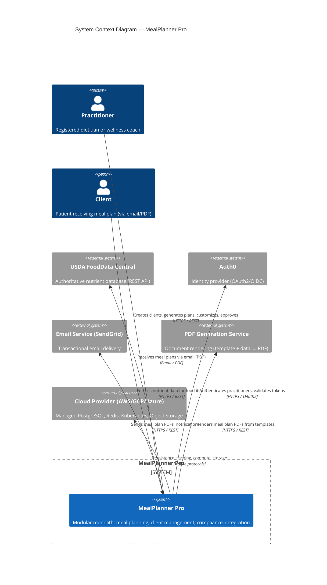

# C4 System Context — MealPlanner Pro

## 1. Document Metadata

| Field | Value |
|-------|-------|
| Document Type | C4 System Context |
| Architecture Level | C4 Level 1 |
| Lifecycle Phase | Architecture |
| Status | `IN_REVIEW` |
| Version | `0.2` |
| System | MealPlanner Pro |
| Owner | Architect |
| Created | `2025-01-26` |
| Last Updated | `2025-01-29` |
| Architecture Baseline | `ARCH-CTX-001` v0.3 |
| Domain Boundary Review | `DOM-BC-001` v0.2 (PROPOSED) |
| Product Discovery Summary | `PROD-CTX-001` v0.3 |

---

## 2. Purpose

Show the system boundary, external actors, and external systems for MealPlanner Pro.

---

## 3. System Context Diagram



---

## 4. Element Descriptions

| Element | Type | Description |
|---------|------|-------------|
| Practitioner | Person | Primary user; creates clients, requests meal plans, customizes, approves delivery |
| Client | Person | Receives meal plan PDF via email; no direct system access in MVP |
| MealPlanner Pro | Software System | Modular monolith containing Nutrition Planning, Client Management, Compliance, Integration modules |
| USDA FoodData Central | External System | Authoritative food composition database; rate-limited free tier (1,000 req/day) |
| Auth0 | External System | OAuth2/OIDC identity provider; issues JWTs with role claims |
| Email Service | External System | Transactional email delivery (SendGrid or similar); template support |
| PDF Generation Service | External System | Renders HTML/templates + data → PDF bytes; timeout/retry handling |
| Cloud Provider | External System | Managed services: PostgreSQL, Redis, Kubernetes (EKS/GKE), Object Storage (S3/GCS) |

---

## 5. System Boundary Rationale

**Inside Boundary (MealPlanner Pro):**
- All business logic (4 modules)
- Event bus (in-process)
- API layer (REST controllers)
- Shared kernel (ClientIdentity)

**Outside Boundary:**
- USDA API — External data source, not owned
- Auth0 — Identity management, not owned
- Email/PDF — Delivery mechanisms, not core domain
- Cloud Infrastructure — Managed services, not application logic

**Boundary Decisions:**
- `ADR-001`: Modular monolith keeps all modules inside single deployable
- `ADR-002`: In-process communication for module-to-module; async events for cross-context
- `ADR-003`: Per-context schemas inside single PostgreSQL instance

---

## 6. Quality Attributes at System Level

| Attribute | Expectation | How Addressed |
|---------|-------------|---------------|
| **Security** | Health data encrypted, audited, consent-enforced | TLS, AES-256, OAuth2, consent checks, audit log |
| **Availability** | 99.5% business hours | Single AZ (MVP), health checks, graceful degradation |
| **Performance** | Plan generation < 30s p95 | USDA caching, async delivery, connection pooling |
| **Scalability** | 100 practitioners × 50 clients | Horizontal pod scaling, managed services |
| **Maintainability** | Modular boundaries, dependency rules | Hexagonal per module, ArchUnit tests |

---

## 7. Traceability

| Relationship | Artifact | Status |
|--------------|----------|--------|
| `DERIVES_FROM` | `ARCH-CTX-001` | `VALID` |
| `DERIVES_FROM` | `DOM-BC-001` | `VALID` |
| `SATISFIES` | `PROD-REQ-001` | `VALID` |
| `REALIZES` | `CAP-001`..`CAP-007` | `VALID` |
| `EXPOSES` | `API-CONTRACT-001`, `API-CONTRACT-002` | `VALID` |
| `CONSUMES` | USDA, Auth0, Email, PDF contracts | `VALID` |

---

## 8. Evidence

| Evidence | Type | Source | Confidence |
|----------|------|--------|------------|
| Architecture Context (`ARCH-CTX-001`) | `DOCUMENT` | Architecture | `HIGH` |
| Bounded Contexts (`DOM-BC-001`) | `DOCUMENT` | Domain | `HIGH` |
| ADR-001 (Modular Monolith) | `DOCUMENT` | Decisions | `HIGH` |
| Technical spike prototype | `CODE` | Engineering | `HIGH` |

---

## 9. Review Status

```
Status: IN_REVIEW
Gate 3: PASSED_WITH_RISKS (see Architecture Context gate result)
```

---

## 10. Change History

| Version | Date | Change | Author |
|---------|------|--------|--------|
| `0.1` | `2025-01-26` | Initial diagram from architecture context | Agent |
| `0.2` | `2025-01-29` | Updated after DOM-DEC-001 authorization | Agent |